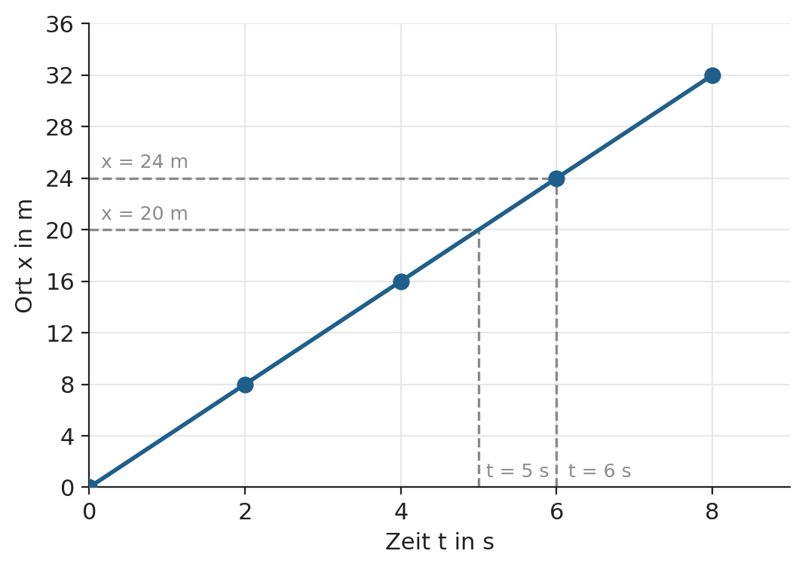
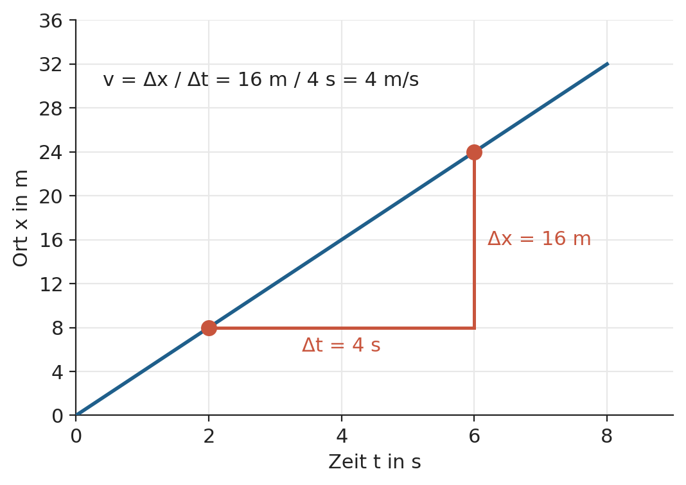
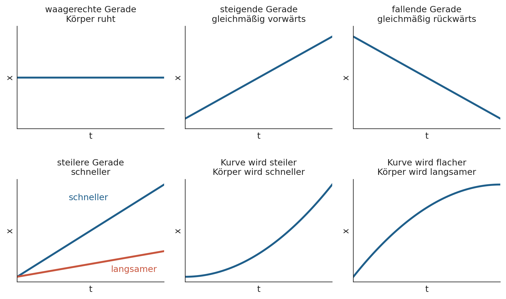
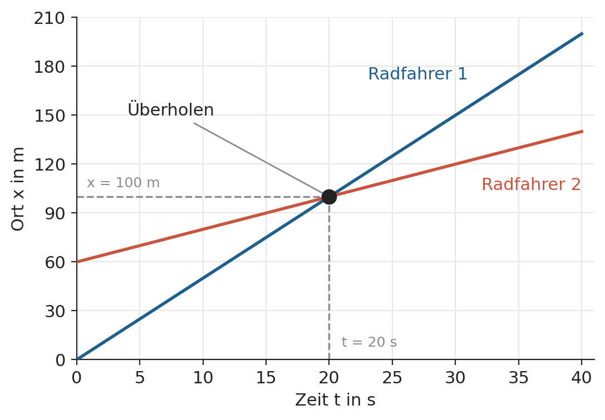

# Zeit-Ort-Diagramme: Bewegungen darstellen und lesen

Um eine Bewegung zu beschreiben, muss man wissen: **Wo ist der Körper zu welcher Zeit?** Ein Zeit-Ort-Diagramm zeigt genau das auf einen Blick. Hier geht es darum, solche Diagramme zu zeichnen und zu lesen. Wie man die Verläufe mathematisch beschreibt, kommt später.

---

## Was wird dargestellt?

- **Ort $x$:** die Position des Körpers auf einer geraden Linie, gemessen von einem festgelegten Nullpunkt aus (z. B. Haustür, Startlinie). Einheit z. B. m oder km.
- **Zeit $t$:** die Zeit seit Beginn der Beobachtung. Einheit z. B. s oder min.

Im Diagramm steht die **Zeit auf der waagerechten Achse** und der **Ort auf der senkrechten Achse**. Jeder Punkt bedeutet: *„Zur Zeit $t$ befand sich der Körper am Ort $x$."*

> **Wichtig:** Das Diagramm ist kein Bild der Strecke. Auch wenn ein Auto auf einer ganz geraden Straße fährt, zeigt das Diagramm nicht die Straße, sondern **wie sich der Ort mit der Zeit ändert**.

Der Ort kann auch **negativ** sein. Das bedeutet nur, dass der Körper auf der anderen Seite des Nullpunkts ist.

---

## Vom Messwert zum Diagramm

Ein Läufer wird alle 2 Sekunden erfasst. Seinen Ort misst man von der Startlinie aus.

| Zeit $t$ in s | Ort $x$ in m |
|---|---|
| 0 | 0 |
| 2 | 8 |
| 4 | 16 |
| 6 | 24 |
| 8 | 32 |

Vorgehen:

1. **Achsen** zeichnen und mit Größe und Einheit beschriften ($t$ in s, $x$ in m).
2. **Skalen** gleichmäßig wählen, sodass alle Werte gut hineinpassen.
3. **Punkte** eintragen.
4. Die Punkte **verbinden**, wenn man annehmen darf, dass sich der Körper zwischen den Messwerten gleichmäßig weiterbewegt.

So sieht das Diagramm zur Tabelle des Läufers aus. Die gestrichelten Linien werden im nächsten Abschnitt erklärt.

Die Punkte liegen auf einer **Geraden**, die im Nullpunkt beginnt und gleichmäßig ansteigt. Mit jeder weiteren Sekunde ist der Läufer 4 m weiter von der Startlinie entfernt.

---

## Was man im Diagramm ablesen kann

- **Ort zu einer bestimmten Zeit:** von der Zeitachse senkrecht nach oben bis zur Linie, dann waagerecht zur Ortsachse.
- **Zeit für einen bestimmten Ort:** von der Ortsachse waagerecht bis zur Linie, dann senkrecht zur Zeitachse.
- **Startort:** der Wert bei $t = 0$. Der Körper muss nicht im Nullpunkt starten.

Im Diagramm des Läufers oben (gestrichelte Linien):

- **Ort zu einer Zeit:** Bei $t = 5$ s liest man $x = 20$ m ab. Dieser Wert steht nicht in der Tabelle, lässt sich aber auf der Linie ablesen.
- **Zeit zu einem Ort:** Den Ort $x = 24$ m erreicht der Läufer bei $t = 6$ s.

---

## Die Steigung: So erkennt man die Geschwindigkeit

Je **steiler** die Linie, desto **mehr Ort** legt der Körper in der gleichen Zeit zurück, also desto **schneller** ist er.

Die Geschwindigkeit lässt sich aus der Steigung bestimmen. Man wählt zwei Punkte der Linie und liest ab, wie sich Ort und Zeit ändern (**Steigungsdreieck**):

$$v = \frac{\text{Änderung des Ortes}}{\text{Änderung der Zeit}} = \frac{\Delta x}{\Delta t}$$

Beim Läufer von oben wählen wir zwei Punkte, zum Beispiel $t = 2$ s und $t = 6$ s. Der Ort ändert sich dabei von 8 m auf 24 m.

Das **waagerechte** Stück des Dreiecks ist die Zeitspanne $\Delta t = 4$ s, das **senkrechte** Stück die Ortsänderung $\Delta x = 16$ m:

$$v = \frac{16\ \text{m}}{4\ \text{s}} = 4\ \frac{\text{m}}{\text{s}}$$

Bei einer Geraden ist die Steigung überall gleich. Jedes andere Punktepaar liefert dasselbe Ergebnis, zum Beispiel $t = 0$ s bis $t = 8$ s mit $\dfrac{32\ \text{m}}{8\ \text{s}} = 4\ \dfrac{\text{m}}{\text{s}}$. Je weiter die Punkte auseinanderliegen, desto genauer lässt sich die Steigung ablesen.

*Umrechnung:* Man multipliziert den Wert in m/s mit 3,6 und erhält km/h. Der Läufer ist also mit 14,4 km/h unterwegs.

**Das Vorzeichen** der Geschwindigkeit zeigt die Richtung an:

- **positiv** (Linie steigt): Der Körper bewegt sich in Richtung wachsender Ortswerte.
- **negativ** (Linie fällt): Der Körper bewegt sich zurück, in Richtung kleinerer Ortswerte.

---

## Typische Verläufe

| Verlauf im Diagramm | Bedeutung |
|---|---|
| waagerechte Gerade | Der Körper **ruht** ($v = 0$). |
| steigende Gerade | Der Körper bewegt sich **gleichmäßig vorwärts** (konstante Geschwindigkeit). |
| fallende Gerade | Der Körper bewegt sich **gleichmäßig rückwärts**. |
| steilere Gerade | Der Körper ist **schneller**. |
| Kurve, die steiler wird | Der Körper wird **schneller**. |
| Kurve, die flacher wird | Der Körper wird **langsamer**. |

Eine **Gerade** steht immer für eine Bewegung mit **konstanter Geschwindigkeit** (gleichförmige Bewegung). Bei einer **Kurve** ändert sich die Geschwindigkeit. Die Steigung ist dann an jeder Stelle anders.

---

## Mehrere Körper im selben Diagramm

Man kann zwei Bewegungen in dasselbe Diagramm zeichnen, am besten in verschiedenen Farben.

> Wo sich zwei Linien **schneiden**, sind beide Körper **zur selben Zeit am selben Ort**. Der Schnittpunkt ist eine **Begegnung** (oder ein Überholvorgang).

So lassen sich Fragen beantworten wie: *Wann und wo treffen sich zwei Fahrzeuge?*

**Beispiel:** Radfahrer 2 fährt langsam los und ist bei $t = 0$ schon 60 m vom Nullpunkt entfernt. Radfahrer 1 startet im Nullpunkt, ist aber schneller.

- Die **steilere** Linie (Radfahrer 1) ist die schnellere Bewegung.
- Die Linien schneiden sich bei $t = 20$ s und $x = 100$ m. Dort **überholt** Radfahrer 1 den Radfahrer 2.
- **Vor** dem Schnittpunkt liegt die Linie von Radfahrer 2 oben, er ist also weiter vorn. **Nach** dem Schnittpunkt liegt Radfahrer 1 oben, er ist jetzt vorn.

---

## Häufige Fehler

- **Steigung mit Höhe verwechseln:** Eine waagerechte Linie heißt nicht „schnell", sondern **Stillstand**.
- **Das Diagramm für eine Bahn halten:** Eine fallende Linie bedeutet nicht, dass der Körper „bergab" fährt, sondern dass der Ort kleiner wird.
- **Ort mit zurückgelegter Strecke verwechseln:** Wer 100 m hin und 100 m zurück geht, ist am Ende wieder am Startort. Der Ort ist dann 0, die zurückgelegte Strecke 200 m.
- **Achsen ohne Beschriftung und Einheit** zeichnen. Ohne Angaben ist das Diagramm wertlos.

---

## Zusammenfassung

1. Ein Zeit-Ort-Diagramm zeigt, **wo** ein Körper **wann** ist: $t$ waagerecht, $x$ senkrecht.
2. Die **Steigung** der Linie ist die **Geschwindigkeit**: $v = \dfrac{\Delta x}{\Delta t}$.
3. **Waagerecht** heißt Stillstand, **steigend** vorwärts, **fallend** rückwärts.
4. Eine **Gerade** bedeutet konstante Geschwindigkeit, eine **Kurve** veränderliche Geschwindigkeit.
5. Der **Schnittpunkt** zweier Linien zeigt, wann und wo sich zwei Körper begegnen.
