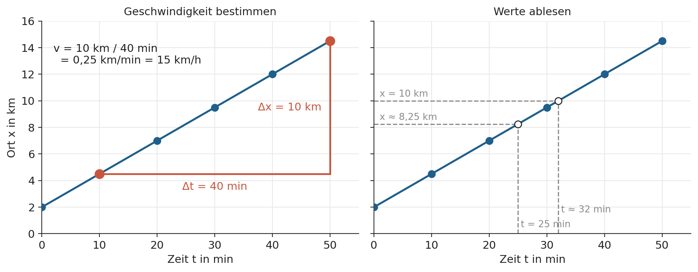
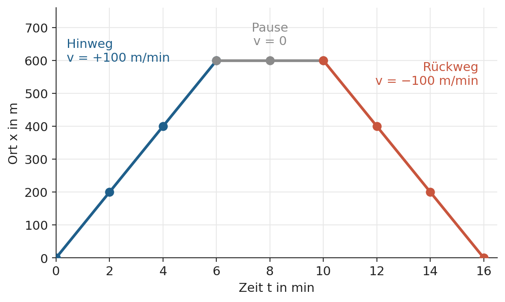
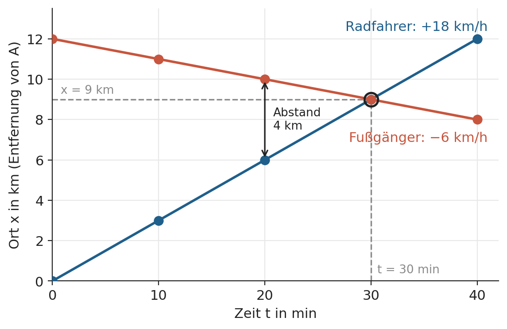
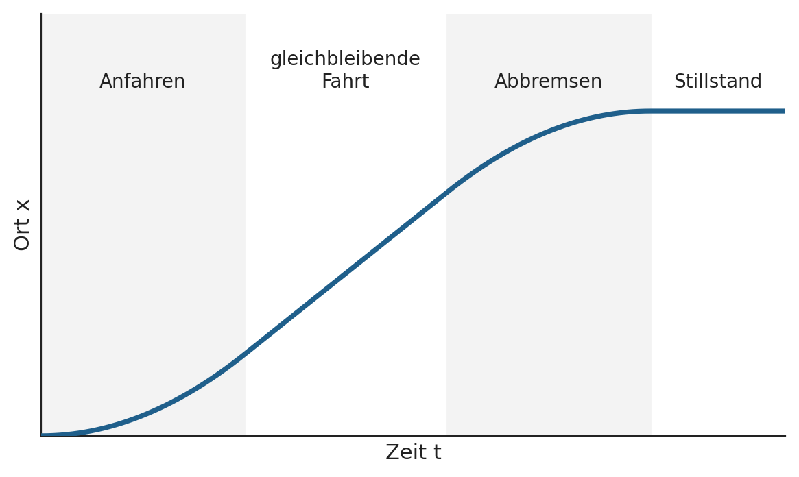

# Musterlösung: Zeit-Ort-Diagramme lesen und zeichnen

**Klasse 11 · Mechanik · Bewegungen im Zeit-Ort-Diagramm · für die Lehrkraft**

Musterlösung zur [Übungsaufgabe](zeit-ort-diagramm-uebung.md). Grundlage ist der Text [Zeit-Ort-Diagramme: Bewegungen darstellen und lesen](zeit-ort-diagramm-grundlagen.md).

---

## Variante A

Konstante Geschwindigkeit $v = 15$ km/h, Startort $x_0 = 2$ km.

**1.** Die Punkte liegen auf einer **steigenden Geraden**, die bei 2 km beginnt (nicht im Nullpunkt).

**2.** Eine Gerade bedeutet konstante Geschwindigkeit (gleichförmige Bewegung). Die Linie steigt, also fährt die Radfahrerin in Richtung wachsender Ortswerte (von der Brücke weg).

**3.** Beispiel (linkes Diagramm): Zwischen $t = 10$ min und $t = 50$ min ändert sich der Ort von 4,5 km auf 14,5 km, also um $\Delta x = 10$ km in $\Delta t = 40$ min.
$v = \dfrac{10\ \text{km}}{40\ \text{min}} = 0{,}25\ \dfrac{\text{km}}{\text{min}} = 15\ \dfrac{\text{km}}{\text{h}}$

**4.**
- Nach 25 min: ca. $x = 8{,}25$ km (rechtes Diagramm, zwischen den Messpunkten 7,0 km und 9,5 km).
- $x = 10$ km wird nach ca. $t = 32$ min erreicht.

**5.** Die Radfahrerin startet 2 km von der Brücke entfernt. Der Startort verschiebt die Linie nach oben, ändert aber die **Steigung** nicht. Die Geschwindigkeit ist davon unabhängig.

---

## Variante B

**1.** Das Diagramm besteht aus drei Abschnitten: steigende Gerade, waagerechte Gerade, fallende Gerade.

**2.**

| Abschnitt | Form | Bedeutung |
|---|---|---|
| 0 bis 6 min | steigende Gerade | Mia geht zur Bäckerei |
| 6 bis 10 min | waagerechte Gerade | Mia bleibt stehen (kauft ein) |
| 10 bis 16 min | fallende Gerade | Mia geht zurück nach Hause |

**3.**
- 0 bis 6 min: $v = \dfrac{600\ \text{m}}{6\ \text{min}} = +100\ \dfrac{\text{m}}{\text{min}}$
- 6 bis 10 min: $v = 0$
- 10 bis 16 min: $v = \dfrac{0\ \text{m} - 600\ \text{m}}{6\ \text{min}} = -100\ \dfrac{\text{m}}{\text{min}}$

(100 m/min entsprechen 6 km/h.)

**4.**
- Nach 5 min: 500 m. Nach 13 min: 300 m.
- 300 m Entfernung: nach 3 min (auf dem Hinweg) und nach 13 min (auf dem Rückweg).

**5.**
- Das negative Vorzeichen zeigt an, dass sich Mia in Richtung kleinerer Ortswerte bewegt, also zurück zur Haustür.
- Zurückgelegter Weg: 600 m + 600 m = **1200 m**. Ort am Ende: **0 m** (wieder zu Hause).

---

## Variante C

**1.** Die Linie des Radfahrers steigt, die des Fußgängers fällt. Beide schneiden sich bei $t = 30$ min.

**2.** Radfahrer: steigende Gerade, bewegt sich von A weg auf B zu. Fußgänger: fallende Gerade, bewegt sich von B weg auf A zu. Beide haben konstante Geschwindigkeit.

**3.**
- Radfahrer: $v = \dfrac{12\ \text{km}}{40\ \text{min}} = 0{,}3\ \dfrac{\text{km}}{\text{min}} = +18\ \dfrac{\text{km}}{\text{h}}$
- Fußgänger: $v = \dfrac{8\ \text{km} - 12\ \text{km}}{40\ \text{min}} = -0{,}1\ \dfrac{\text{km}}{\text{min}} = -6\ \dfrac{\text{km}}{\text{h}}$

(Das negative Vorzeichen zeigt die Gegenrichtung. Der Betrag, also die Schnelligkeit, ist 6 km/h.)

**4.** Begegnung nach **30 min** bei $x = 9$ km von A entfernt. Im Diagramm ist es der **Schnittpunkt** der beiden Linien: gleicher Ort zur gleichen Zeit.

**5.**
- Nach 20 min: Radfahrer bei 6 km, Fußgänger bei 10 km, Abstand **4 km** (Doppelpfeil im Diagramm).
- Bis zur Begegnung: Radfahrer **9 km**, Fußgänger $12 - 9 = $ **3 km**. Der Radfahrer ist dreimal so schnell und legt deshalb dreimal so viel Weg zurück.

---

## Abschluss

| Gruppe | Bewegung | Verlauf im Diagramm | Wichtigste Erkenntnis |
|---|---|---|---|
| A | gleichförmig, Startort $\neq 0$ | steigende Gerade ab 2 km | Steigung = Geschwindigkeit, der Startort verschiebt nur die Linie |
| B | Hinweg, Pause, Rückweg | steigend, waagerecht, fallend | waagerecht = Stillstand, fallend = negative Geschwindigkeit |
| C | zwei Körper, gegenläufig | steigende und fallende Gerade | Schnittpunkt = Begegnung (Ort und Zeit) |

Gemeinsame Aussage: **Waagerecht** heißt ruhen, **steigend** vorwärts, **fallend** rückwärts. **Steiler** heißt schneller, und bei einer **Kurve** ändert sich die Geschwindigkeit.

---

## Zusatzaufgabe

| Abschnitt | Verlauf in der Skizze |
|---|---|
| Anfahren (wird schneller) | Kurve, die immer **steiler** wird |
| gleichbleibende Fahrt | **Gerade** (steigend) |
| Abbremsen (wird langsamer) | Kurve, die immer **flacher** wird |
| Stillstand im Bahnhof | **waagerechte** Linie |

Die Linie steigt insgesamt an, weil sich der Zug vorwärts bewegt. Sie wird im Bahnhof am Ende waagerecht. An den Übergängen gibt es keinen Knick: Die Geschwindigkeit ändert sich nicht sprunghaft, deshalb gehen die Abschnitte glatt ineinander über.

---

## Hinweis für die Lehrkraft

Alle Werte sind so gewählt, dass die Geschwindigkeiten glatte Zahlen ergeben (A: 15 km/h, B: ±100 m/min, C: +18 km/h und −6 km/h). Die Aufgaben nutzen nur Geraden. Die Zusatzaufgabe führt Kurven nur qualitativ ein, ohne Berechnung.

Die Diagramme liegen als PNG-Dateien im Ordner [bilder/](bilder). Der Ordner muss neben den Markdown-Dateien liegen, damit die Bilder angezeigt werden.
