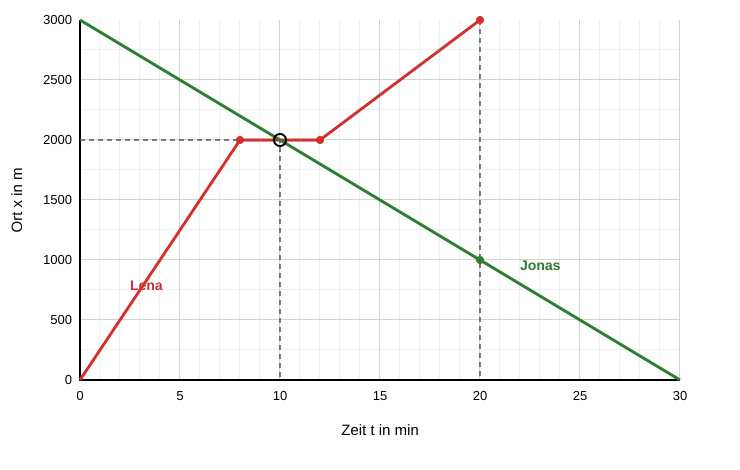

# Musterlösung: Prüfung Zeit-Ort-Diagramme

**Klasse 11 · Mechanik · Bewegungen im Zeit-Ort-Diagramm · für die Lehrkraft**

Musterlösung zur [Prüfung](zeit-ort-diagramm-pruefung.md). Gesamtpunktzahl: 34 Punkte.

---

## Aufgabe 1: Toms Radtour (17 Punkte)

**a)** *(4 Punkte, je Abschnitt 1 Punkt)*

| Abschnitt | Form der Linie | Bedeutung |
|---|---|---|
| 0 bis 20 min | steigende Gerade | Tom fährt vorwärts (0 km → 6 km) |
| 20 bis 30 min | waagerechte Gerade | Tom steht bei 6 km, der Ort ändert sich nicht |
| 30 bis 50 min | steilere steigende Gerade | Tom fährt schneller vorwärts (6 km → 14 km) |
| 50 bis 70 min | fallende Gerade | Tom fährt rückwärts zum Startpunkt hin (14 km → 8 km) |

**b)** *(5 Punkte: 3 für die Geschwindigkeiten, 1 für die Umrechnung, 1 für das Vorzeichen)*

- 0 bis 20 min: $v = \dfrac{6\ \text{km} - 0\ \text{km}}{20\ \text{min}} = +0{,}3\ \dfrac{\text{km}}{\text{min}} = +18\ \dfrac{\text{km}}{\text{h}}$
- 30 bis 50 min: $v = \dfrac{14\ \text{km} - 6\ \text{km}}{20\ \text{min}} = +0{,}4\ \dfrac{\text{km}}{\text{min}} = +24\ \dfrac{\text{km}}{\text{h}}$
- 50 bis 70 min: $v = \dfrac{8\ \text{km} - 14\ \text{km}}{20\ \text{min}} = -0{,}3\ \dfrac{\text{km}}{\text{min}} = -18\ \dfrac{\text{km}}{\text{h}}$

Das positive Vorzeichen bedeutet Bewegung in Richtung wachsender Ortswerte (vom Startpunkt weg). Das negative Vorzeichen bedeutet Bewegung in Richtung kleinerer Ortswerte (zum Startpunkt hin).

**c)** *(3 Punkte)*

- Gesamtweg: $6\ \text{km} + 8\ \text{km} + 6\ \text{km} = 20\ \text{km}$
- Ort am Ende: $x = 8$ km

Der Weg ist die Summe aller zurückgelegten Strecken, unabhängig von der Richtung. Der Ort gibt nur an, wo Tom am Ende vom Startpunkt aus steht. Weil Tom zuletzt 6 km zurückfährt, ist der Ort kleiner als der Weg.

**d)** *(2 Punkte)*

$\bar v = \dfrac{6\ \text{km}}{30\ \text{min}} = 0{,}2\ \dfrac{\text{km}}{\text{min}} = 12\ \dfrac{\text{km}}{\text{h}}$

Tom hat in den ersten 30 Minuten eine Durchschnittsgeschwindigkeit von $12\ \dfrac{\text{km}}{\text{h}}$.

**e)** *(3 Punkte: 1 für die Ablesung beider Zeiten, 2 für die Rechnung)*

Die Linie erreicht $x = 10$ km zweimal, einmal auf der Hinfahrt und einmal auf der Rückfahrt. Aus dem Diagramm ergibt sich ungefähr $t \approx 40$ min und $t \approx 63$ min.

- Hinfahrt (30 bis 50 min): $x(t) = 6\ \text{km} + 0{,}4\ \dfrac{\text{km}}{\text{min}} \cdot (t - 30\ \text{min}) = 10\ \text{km}$, also $t - 30\ \text{min} = 10\ \text{min}$ und damit $t = 40$ min.
- Rückfahrt (50 bis 70 min): $x(t) = 14\ \text{km} - 0{,}3\ \dfrac{\text{km}}{\text{min}} \cdot (t - 50\ \text{min}) = 10\ \text{km}$, also $t - 50\ \text{min} = 13{,}3\ \text{min}$ und damit $t \approx 63{,}3$ min.

Tom befindet sich nach 40 min und nach etwa 63 min bei $x = 10$ km.

---

## Aufgabe 2: Lena und Jonas (17 Punkte)

**a)** *(3 Punkte)*

- Ort der Panne: $x = 250\ \dfrac{\text{m}}{\text{min}} \cdot 8\ \text{min} = 2000$ m
- Die Reparatur dauert bis $t = 8\ \text{min} + 4\ \text{min} = 12$ min.
- Restweg bis zum See: $3000\ \text{m} - 2000\ \text{m} = 1000\ \text{m}$. Dauer: $\Delta t = \dfrac{1000\ \text{m}}{125\ \text{m/min}} = 8$ min.
- Ankunft am See: $t = 12\ \text{min} + 8\ \text{min} = 20$ min.

**b)** *(5 Punkte)*

Lena: Eckpunkte $(0\ \text{min}\,|\,0\ \text{m})$, $(8\,|\,2000)$, $(12\,|\,2000)$ und $(20\,|\,3000)$, durch Geraden verbunden. *(3 Punkte)*

Jonas: Gerade von $(0\,|\,3000)$ nach $(30\,|\,0)$. Den Endpunkt erhält man aus $\Delta t = \dfrac{3000\ \text{m}}{100\ \text{m/min}} = 30$ min. *(2 Punkte)*

**c)** *(4 Punkte: 2 für die Ablesung, 2 für die Rechnung)*

Aus dem Diagramm: Die Linien schneiden sich bei $t = 10$ min und $x = 2000$ m. Lena steht dort gerade wegen ihrer Panne.

Rechnung: Jonas' Ortsfunktion lautet $x_J(t) = 3000\ \text{m} - 100\ \dfrac{\text{m}}{\text{min}} \cdot t$. Während der Pause ($8\ \text{min} \le t \le 12\ \text{min}$) gilt $x_L = 2000$ m.

$3000\ \text{m} - 100\ \dfrac{\text{m}}{\text{min}} \cdot t = 2000\ \text{m} \Rightarrow t = 10\ \text{min}$

Dieser Zeitpunkt liegt in der Pause, die Rechnung ist damit gültig. Lena und Jonas begegnen sich nach 10 min bei $x = 2000$ m.

**d)** *(2 Punkte)*

Lena kommt bei $t = 20$ min am See an ($x = 3000$ m). Jonas ist dann bei $x = 3000\ \text{m} - 100\ \dfrac{\text{m}}{\text{min}} \cdot 20\ \text{min} = 1000$ m.

Der Abstand beträgt $3000\ \text{m} - 1000\ \text{m} = 2000$ m.

**e)** *(3 Punkte)*

$\bar v = \dfrac{3000\ \text{m}}{20\ \text{min}} = 150\ \dfrac{\text{m}}{\text{min}} = 150 \cdot \dfrac{60}{1000}\ \dfrac{\text{km}}{\text{h}} = 9\ \dfrac{\text{km}}{\text{h}}$

Lenas Durchschnittsgeschwindigkeit beträgt $9\ \dfrac{\text{km}}{\text{h}}$.
