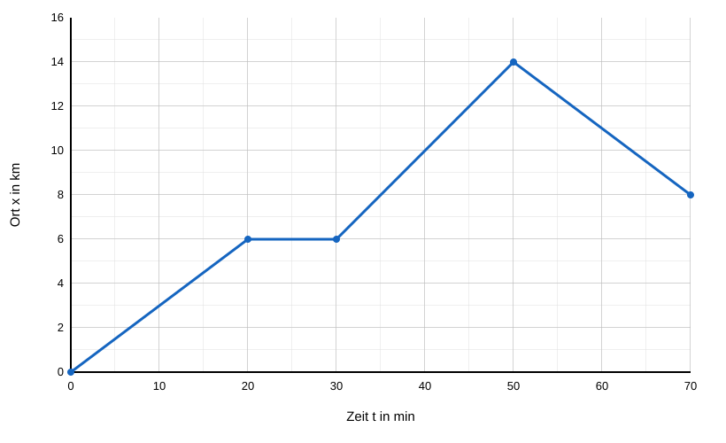
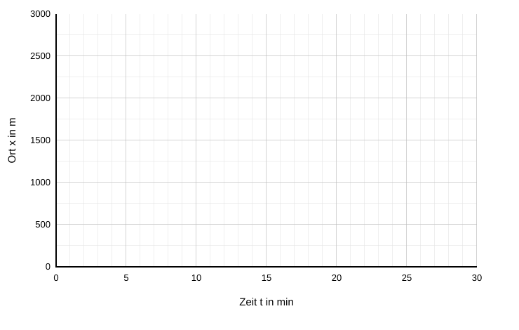

# Schriftliche Übung: Zeit-Ort-Diagramme

Name: ______________________________  Datum: ______________  Punkte: ______ / 34

## Aufgabe 1: Toms Radtour (17 Punkte)

Tom unternimmt eine Radtour auf einer geraden Straße. Der Ort $x$ wird vom **Startpunkt** aus gemessen ($x = 0$). Sein Fahrradcomputer hat das folgende Zeit-Ort-Diagramm aufgezeichnet:

**a)** Beschreiben Sie Toms Bewegung in den vier Abschnitten (vorwärts, rückwärts oder Stillstand) und begründen Sie Ihre Aussage jeweils mit der Form der Linie im Diagramm. *(4 Punkte)*

**b)** Bestimmen Sie Toms Geschwindigkeit in **allen Abschnitten mit Bewegung** in der Einheit $\dfrac{\text{km}}{\text{h}}$. Erklären Sie die Bedeutung des Vorzeichens. *(5 Punkte)*

**c)** Geben Sie den **Gesamtweg** und den **Ort am Ende** der Fahrt an. Begründen Sie, warum die beiden Werte verschieden sind. *(3 Punkte)*

**d)** Berechnen Sie Toms Durchschnittsgeschwindigkeit in den ersten 30 Minuten (einschließlich der Pause). *(2 Punkte)*

**e)** Bestimmen Sie alle Zeitpunkte, zu denen sich Tom bei $x = 10$ km befindet. Lesen Sie die Werte im Diagramm ab und überprüfen Sie sie durch Rechnung. *(3 Punkte)*

## Aufgabe 2: Lena und Jonas (17 Punkte)

Zwischen dem **Bahnhof** ($x = 0$) und dem **See** ($x = 3000$ m) verläuft ein gerader Weg. Zum Zeitpunkt $t = 0$ starten zwei Personen:

- **Lena** fährt mit dem Rad vom Bahnhof zum See. Sie fährt zunächst mit $v = +250\ \dfrac{\text{m}}{\text{min}}$ und hat nach 8 min eine Panne. Die Reparatur dauert 4 min. Danach schiebt sie ihr Rad mit $v = +125\ \dfrac{\text{m}}{\text{min}}$ bis zum See.
- **Jonas** geht gleichzeitig vom See zum Bahnhof, und zwar mit der konstanten Geschwindigkeit $v = -100\ \dfrac{\text{m}}{\text{min}}$.

**a)** Bestimmen Sie den Ort, an dem Lena ihre Panne hat, und berechnen Sie, zu welchem Zeitpunkt sie den See erreicht. *(3 Punkte)*

**b)** Zeichnen Sie die Zeit-Ort-Diagramme von Lena und Jonas in das Koordinatensystem ein. Verwenden Sie zwei verschiedene Farben. *(5 Punkte)*

**c)** Bestimmen Sie Zeitpunkt und Ort, an dem sich Lena und Jonas begegnen, zunächst zeichnerisch und überprüfen Sie das Ergebnis anschließend rechnerisch. *(4 Punkte)*

**d)** Geben Sie an, wie weit Lena und Jonas voneinander entfernt sind, wenn Lena am See ankommt. *(2 Punkte)*

**e)** Berechnen Sie Lenas Durchschnittsgeschwindigkeit für die gesamte Fahrt (einschließlich der Pause) in der Einheit $\dfrac{\text{km}}{\text{h}}$. *(3 Punkte)*
