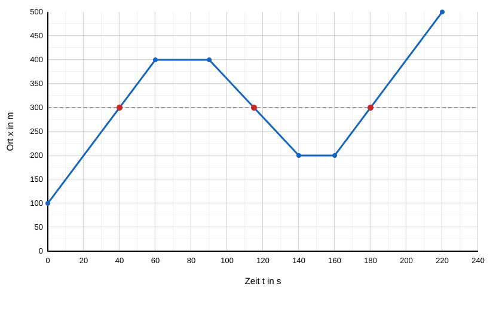
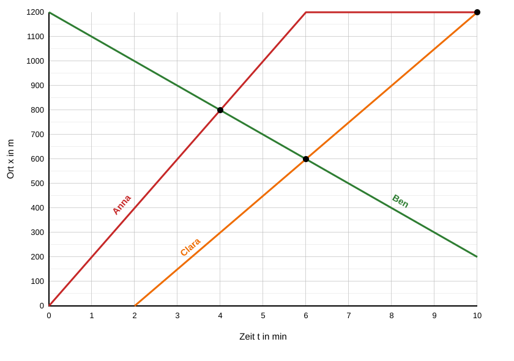

# Musterlösung: Zeit-Ort-Diagramme lesen, zeichnen und vergleichen

**Klasse 11 · Mechanik · Bewegungen im Zeit-Ort-Diagramm · für die Lehrkraft**

Musterlösung zum [Arbeitsblatt](zeit-ort-diagramm-uebung-2.md). Grundlage ist der Text [Zeit-Ort-Diagramme: Bewegungen darstellen und lesen](zeit-ort-diagramm-grundlagen.md).

---

## Aufgabe 1: Robi, der Pausenroboter

**a)**

| Abschnitt | Form der Linie | Bedeutung | gleichförmig? |
|---|---|---|---|
| 0 bis 20 s | steigende Gerade | Robi fährt vorwärts (0 m → 40 m) | ja |
| 20 bis 30 s | waagerechte Gerade | Robi steht bei 40 m | – (Stillstand) |
| 30 bis 50 s | steilere steigende Gerade | Robi fährt schneller vorwärts (40 m → 100 m) | ja |
| 50 bis 70 s | gekrümmte, immer steiler werdende Linie | Robi fährt vorwärts und wird schneller (100 m → 130 m) | nein |
| 70 bis 90 s | fallende Gerade | Robi fährt rückwärts, zum Kiosk hin (130 m → 50 m) | ja |

**b)** Robi steht von $t = 20$ s bis $t = 30$ s. Dort verläuft die Linie waagerecht: Der Ort ändert sich nicht, also ist $v = 0$.

**c)**
- 0 bis 20 s: $v = \dfrac{40\ \text{m} - 0\ \text{m}}{20\ \text{s}} = +2\ \dfrac{\text{m}}{\text{s}}$
- 30 bis 50 s: $v = \dfrac{100\ \text{m} - 40\ \text{m}}{20\ \text{s}} = +3\ \dfrac{\text{m}}{\text{s}}$
- 70 bis 90 s: $v = \dfrac{50\ \text{m} - 130\ \text{m}}{20\ \text{s}} = -4\ \dfrac{\text{m}}{\text{s}}$

Das positive Vorzeichen bedeutet Bewegung in Richtung wachsender Ortswerte (zum Ausgang hin). Das negative Vorzeichen bedeutet Bewegung in Richtung kleinerer Ortswerte (zurück zum Kiosk).

**d)**
- Die Linie ist keine Gerade, sondern gekrümmt. Ihre Steigung ist nicht konstant, also ist auch die Geschwindigkeit nicht konstant. Die Linie wird nach rechts immer steiler, Robi wird also **schneller**.
- Durchschnittsgeschwindigkeit: $\bar v = \dfrac{130\ \text{m} - 100\ \text{m}}{70\ \text{s} - 50\ \text{s}} = \dfrac{30\ \text{m}}{20\ \text{s}} = 1{,}5\ \dfrac{\text{m}}{\text{s}}$

**e)** $\bar v = \dfrac{100\ \text{m} - 0\ \text{m}}{50\ \text{s}} = 2\ \dfrac{\text{m}}{\text{s}}$

Die Pause von 10 s ist dabei eingerechnet.

**f)** Im Abschnitt 70 bis 90 s gilt $|v| = 4\ \dfrac{\text{m}}{\text{s}}$.
$4\ \dfrac{\text{m}}{\text{s}} \cdot 3{,}6 = 14{,}4\ \dfrac{\text{km}}{\text{h}} > 10\ \dfrac{\text{km}}{\text{h}}$

Robi hält sich **nicht** an das Tempolimit. (Das Vorzeichen spielt für den Vergleich keine Rolle, nur der Betrag der Geschwindigkeit.)

**g)**
- Zurückgelegter Weg: $40\ \text{m} + 60\ \text{m} + 30\ \text{m} + 80\ \text{m} = 210\ \text{m}$
- Ort am Ende: $x = 50$ m

Der Weg ist die Summe aller zurückgelegten Strecken, unabhängig von der Richtung. Der Ort gibt nur an, wo Robi am Ende vom Nullpunkt aus steht. Weil Robi zuletzt 80 m zurückfährt, ist der Ort deutlich kleiner als der Weg.

---

## Aufgabe 2: Leons Skate-Tour

**a)** Die Abschnitte laufen von 0 bis 60 s, von 60 bis 90 s, von 90 bis 140 s, von 140 bis 160 s und von 160 bis 220 s.

| Abschnitt | Dauer in s | $v$ in m/s | $\Delta x$ in m | Ort am Ende in m |
|---|---|---|---|---|
| 1 | 60 | +5 | +300 | 400 |
| 2 | 30 | 0 | 0 | 400 |
| 3 | 50 | −4 | −200 | 200 |
| 4 | 20 | 0 | 0 | 200 |
| 5 | 60 | +5 | +300 | 500 |

Dauer von Abschnitt 5: $\Delta t = \dfrac{\Delta x}{v} = \dfrac{300\ \text{m}}{5\ \text{m/s}} = 60\ \text{s}$. Die Tour dauert damit insgesamt 220 s.

**b)** Die Eckpunkte des Diagramms sind $(0\ \text{s}\,|\,100\ \text{m})$, $(60\,|\,400)$, $(90\,|\,400)$, $(140\,|\,200)$, $(160\,|\,200)$ und $(220\,|\,500)$. Sie werden der Reihe nach durch Geraden verbunden. Die gestrichelte Linie bei 300 m gehört zu Teilaufgabe e).

**c)** Abschnitt 1 und Abschnitt 5 haben beide $v = +5\ \dfrac{\text{m}}{\text{s}}$. Im Diagramm sind die beiden Geraden **parallel** (gleiche Steigung). Sie liegen aber an verschiedenen Stellen, weil Leon dort an unterschiedlichen Orten und zu unterschiedlichen Zeiten startet.

**d)** Bei $t = 120$ s befindet sich Leon in Abschnitt 3:
$x = 400\ \text{m} - 4\ \dfrac{\text{m}}{\text{s}} \cdot (120\ \text{s} - 90\ \text{s}) = 280\ \text{m}$

**e)** Leon passiert die Bank **dreimal**:
- Abschnitt 1: $100\ \text{m} + 5\ \dfrac{\text{m}}{\text{s}} \cdot t = 300\ \text{m}$, also $t = 40$ s
- Abschnitt 3: $400\ \text{m} - 4\ \dfrac{\text{m}}{\text{s}} \cdot (t - 90\ \text{s}) = 300\ \text{m}$, also $t = 115$ s
- Abschnitt 5: $200\ \text{m} + 5\ \dfrac{\text{m}}{\text{s}} \cdot (t - 160\ \text{s}) = 300\ \text{m}$, also $t = 180$ s

Im Diagramm sind das die drei Schnittpunkte des Graphen mit der Linie $x = 300$ m.

**f)** Gesamtweg: $300\ \text{m} + 200\ \text{m} + 300\ \text{m} = 800\ \text{m}$ (die Pausen tragen nichts bei).

$\bar v = \dfrac{800\ \text{m}}{220\ \text{s}} \approx 3{,}6\ \dfrac{\text{m}}{\text{s}} \approx 13\ \dfrac{\text{km}}{\text{h}}$

---

## Aufgabe 3: Wettlauf zum Freibad

**a)**
- Anna: $v = \dfrac{1200\ \text{m}}{6\ \text{min}} = +200\ \dfrac{\text{m}}{\text{min}}$ (entspricht 12 km/h)
- Ben: $v = \dfrac{200\ \text{m} - 1200\ \text{m}}{10\ \text{min}} = -100\ \dfrac{\text{m}}{\text{min}}$ (entspricht 6 km/h)
- Nach $t = 6$ min verläuft Annas Graph waagerecht: Sie hat das Freibad ($x = 1200$ m) erreicht und bleibt dort stehen.

**b)** Clara läuft 8 Minuten lang mit $150\ \dfrac{\text{m}}{\text{min}}$:
$150\ \dfrac{\text{m}}{\text{min}} \cdot 8\ \text{min} = 1200\ \text{m}$

Sie erreicht das Freibad also nach $t = 2\ \text{min} + 8\ \text{min} = 10$ min. Ihr Graph ist die Gerade durch $(2\ \text{min}\,|\,0\ \text{m})$ und $(10\ \text{min}\,|\,1200\ \text{m})$.

**c)** Annas Ort ist $x_A = 200\ \dfrac{\text{m}}{\text{min}} \cdot t$, Bens Ort ist $x_B = 1200\ \text{m} - 100\ \dfrac{\text{m}}{\text{min}} \cdot t$.

Gleichsetzen: $200\,t = 1200 - 100\,t$, also $300\,t = 1200$ und $t = 4$ min.
Ort: $x = 200\ \dfrac{\text{m}}{\text{min}} \cdot 4\ \text{min} = 800\ \text{m}$

Anna und Ben treffen sich nach **4 min** bei **800 m**.

**d)** Claras Ort ist $x_C = 150\ \dfrac{\text{m}}{\text{min}} \cdot (t - 2\ \text{min})$.

Gleichsetzen mit Ben: $150\,(t - 2) = 1200 - 100\,t$, also $250\,t = 1500$ und $t = 6$ min.
Ort: $x = 1200\ \text{m} - 100\ \dfrac{\text{m}}{\text{min}} \cdot 6\ \text{min} = 600\ \text{m}$

Clara und Ben treffen sich nach **6 min** bei **600 m**.

Alle drei treffen sich **nicht** gleichzeitig. Anna und Ben begegnen sich bei $t = 4$ min, Clara und Ben erst bei $t = 6$ min. Im Diagramm schneiden sich die drei Graphen nicht in einem gemeinsamen Punkt.

**e)** Clara erreicht Anna nach $t = 10$ min im Freibad bei $x = 1200$ m. Im Diagramm schneidet Claras Gerade die waagerechte Gerade von Anna im Punkt $(10\ \text{min}\,|\,1200\ \text{m})$.

**f)** Bei $t = 4$ min gilt:
- Ben: $x = 800$ m
- Clara: $x = 150\ \dfrac{\text{m}}{\text{min}} \cdot (4 - 2)\ \text{min} = 300\ \text{m}$

Abstand: $800\ \text{m} - 300\ \text{m} = 500\ \text{m}$

**g)** Ben erreicht die Schule bei $x = 0$:
$1200\ \text{m} - 100\ \dfrac{\text{m}}{\text{min}} \cdot t = 0$, also $t = 12$ min.

Ben braucht für den gesamten Weg 12 Minuten, im Diagramm fehlen also noch 2 Minuten bis zur Schule.
