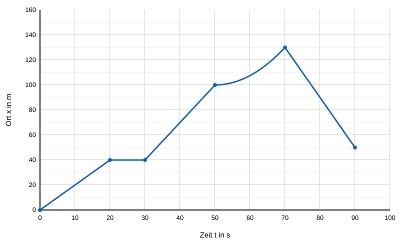
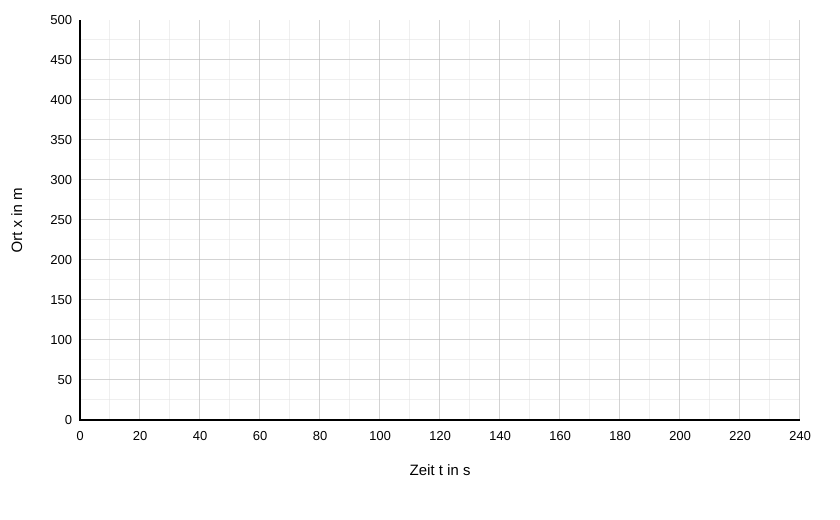
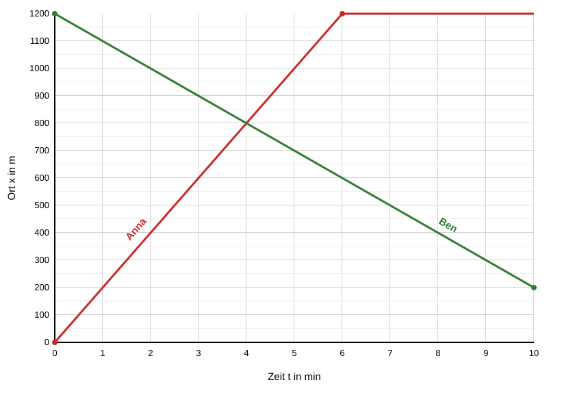

# Arbeitsblatt: Zeit-Ort-Diagramme lesen, zeichnen und vergleichen

**Klasse 11 · Mechanik · Bewegungen im Zeit-Ort-Diagramm**

Das Arbeitsblatt baut auf dem Text [Zeit-Ort-Diagramme: Bewegungen darstellen und lesen](zeit-ort-diagramm-grundlagen.md) auf. Es enthält drei Aufgaben.

## Allgemeine Hinweise

- Alle Bewegungen verlaufen auf einer **geraden Linie**. Der Ort $x$ wird von einem festgelegten Nullpunkt aus angegeben. Bewegungen in Richtung wachsender Ortswerte haben eine positive, entgegengesetzte Bewegungen eine negative Geschwindigkeit.
- Beschriftet die Achsen immer mit Größe und Einheit.
- Geschwindigkeiten bestimmt ihr mit der Steigung: $v = \dfrac{\Delta x}{\Delta t}$.
- Rechnet mit Einheiten und gebt am Ende immer einen Antwortsatz an.

## Aufgabe 1: Robi, der Pausenroboter

In der großen Pause liefert der Roboter **Robi** Snacks durch den geraden Hauptgang der Schule. Der Ort $x$ wird vom Kiosk aus gemessen ($x = 0$), in Richtung Ausgang ist $x$ positiv. Robis Fahrtenschreiber hat das folgende Zeit-Ort-Diagramm aufgezeichnet:

**a)** Teilt die Bewegung in Abschnitte ein. Beschreibt für jeden Abschnitt, was Robi tut (vorwärts, rückwärts oder Stillstand) und ob die Bewegung **gleichförmig** ist.

**b)** In welchen Zeitabschnitten steht Robi? Woran erkennt ihr das im Diagramm?

**c)** Bestimmt die Geschwindigkeit in **allen Abschnitten mit gleichförmiger Bewegung**. Achtet auf das Vorzeichen und erklärt, was es bedeutet.

**d)** Zwischen $t = 50$ s und $t = 70$ s ist die Bewegung **nicht gleichförmig**.
- Begründet anhand der Form der Linie, dass Robi hier nicht mit konstanter Geschwindigkeit fährt. Wird Robi in diesem Abschnitt schneller oder langsamer?
- Berechnet die **Durchschnittsgeschwindigkeit** in diesem Abschnitt.

**e)** Berechnet die Durchschnittsgeschwindigkeit in den **ersten 50 s** (einschließlich der Pause).

**f)** Im Schulgang gilt für Roboter ein Tempolimit von **10 km/h**. Hält sich Robi im Abschnitt von $t = 70$ s bis $t = 90$ s daran? Rechnet dazu in km/h um.

**g)** Welchen **Weg** hat Robi in den 90 s insgesamt zurückgelegt? An welchem **Ort** befindet er sich am Ende? Warum sind die beiden Werte verschieden?

## Aufgabe 2: Leons Skate-Tour

Leon möchte zum Skatepark. Er fährt auf einer geraden Straße, der Ort $x$ wird vom **Schultor** aus gemessen ($x = 0$), der Skatepark liegt bei $x = 500$ m. Zu Beginn ($t = 0$) steht Leon am **Kiosk** bei $x = 100$ m.

Leons Tour verläuft so:

1. Er rollt **60 s** lang mit der konstanten Geschwindigkeit $v = +5\ \dfrac{\text{m}}{\text{s}}$ in Richtung Skatepark.
2. Er trifft Freunde und bleibt **30 s** lang stehen.
3. Dann fällt ihm auf, dass er sein Handy verloren hat. Er dreht um und fährt **50 s** lang mit $v = -4\ \dfrac{\text{m}}{\text{s}}$ zurück.
4. Er findet das Handy und bleibt **20 s** lang an dieser Stelle stehen, um es zu verstauen und die Nachrichten zu lesen.
5. Anschließend fährt er mit $v = +5\ \dfrac{\text{m}}{\text{s}}$ bis zum Skatepark.

**a)** Berechnet zunächst für jeden Abschnitt, wie weit Leon fährt und welchen Ort er am Ende des Abschnitts erreicht. Ergänzt dazu die Tabelle:

| Abschnitt | Dauer in s | $v$ in m/s | Ortsänderung $\Delta x$ in m | Ort am Ende in m |
|---|---|---|---|---|
| 1 | 60 | +5 | | |
| 2 | 30 | | | |
| 3 | 50 | −4 | | |
| 4 | 20 | | | |
| 5 | | +5 | | 500 |

**b)** Zeichnet Leons Zeit-Ort-Diagramm in das Koordinatensystem. Verwendet nur Geraden.

**c)** In zwei Abschnitten fährt Leon mit **gleicher Geschwindigkeit**. Welche Abschnitte sind das? Woran erkennt man das im Diagramm?

**d)** Wo befindet sich Leon nach 120 s?

**e)** Leon kommt an einer Bank bei $x = 300$ m vorbei. Zu welchen Zeiten befindet er sich dort? Lest die Zeiten ab und überprüft sie durch Rechnung.

**f)** Welche **Durchschnittsgeschwindigkeit** hat Leon über die gesamte Tour (Gesamtweg geteilt durch Gesamtzeit)?

## Aufgabe 3: Wettlauf zum Freibad

Zwischen der **Schule** ($x = 0$) und dem **Freibad** ($x = 1200$ m) verläuft ein gerader Weg. An einem heißen Tag sind drei Freunde unterwegs:

- **Anna** fährt mit dem Rad von der Schule zum Freibad. Sie startet bei $t = 0$ und wartet im Freibad auf die anderen.
- **Ben** war schon im Freibad und geht gleichzeitig ($t = 0$) zu Fuß in Richtung Schule, weil er dort seine Sporttasche vergessen hat.
- **Clara** hatte noch Nachsitzen. Sie startet **2 min später** an der Schule und läuft mit der konstanten Geschwindigkeit $v = 150\ \dfrac{\text{m}}{\text{min}}$ zum Freibad.

Die Bewegungen von Anna und Ben sind bereits eingezeichnet:

**a)** Bestimmt aus dem Diagramm Annas Geschwindigkeit in den ersten 6 Minuten und Bens Geschwindigkeit. Was passiert mit Anna nach $t = 6$ min?

**b)** Zeichnet **Claras Bewegung** in dasselbe Diagramm ein, in einer dritten Farbe. Bestimmt dazu zuerst, wo Clara nach 8 Minuten Laufzeit ankommt. Wie lange ist sie insgesamt unterwegs?

**c)** Wann und wo treffen sich **Anna und Ben**? Lest die Werte im Diagramm ab und überprüft sie durch Rechnung (Gleichsetzen der Ortsfunktionen).

**d)** Wann und wo treffen sich **Clara und Ben**? Treffen sich alle drei zur selben Zeit am selben Ort? Begründet.

**e)** Wann erreicht Clara Anna? Woran erkennt man das im Diagramm?

**f)** Wie weit sind Clara und Ben voneinander entfernt, wenn Anna und Ben sich treffen?

**g)** Bens Weg zur Schule dauert länger als die 10 Minuten im Diagramm. Wann würde er die Schule erreichen, wenn er mit gleicher Geschwindigkeit weitergeht?
